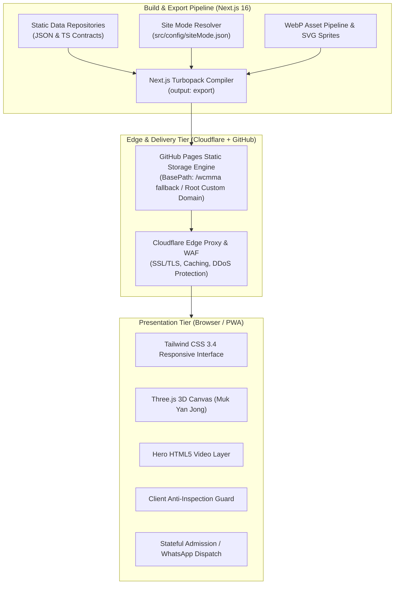
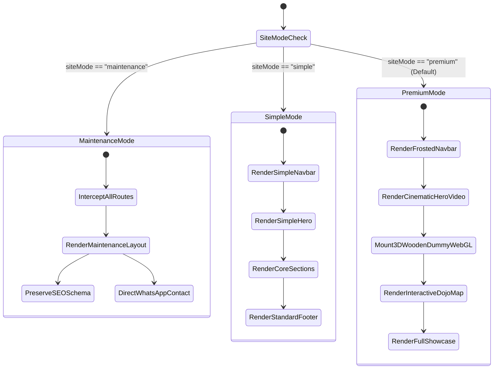
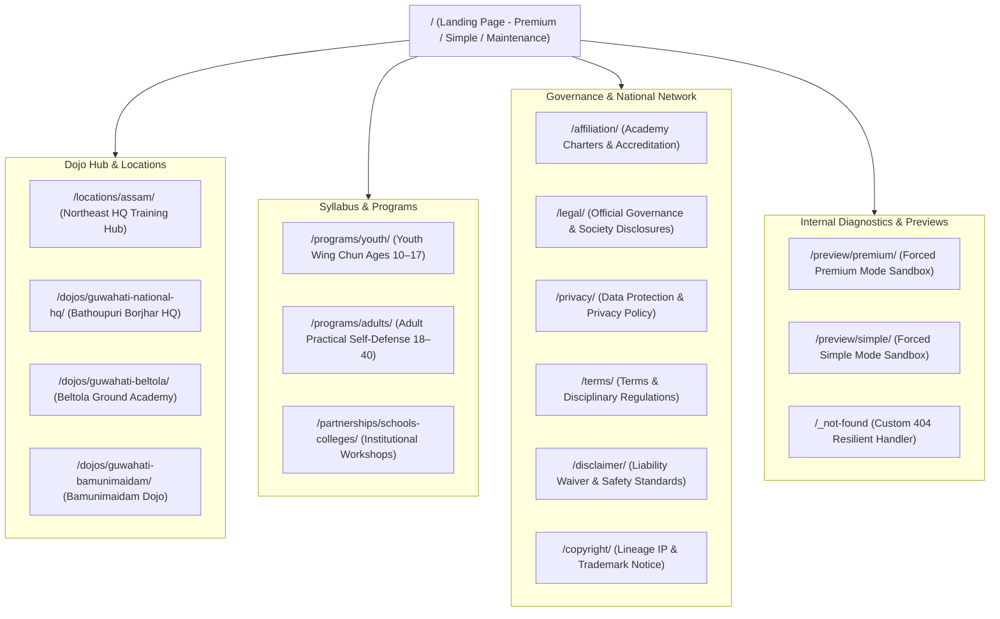

# WCMAA India — Complete System Blueprint & Architecture

**Document Type:** Master Architectural Blueprint & System Taxonomy  
**System Target:** Wing Chun Martial Arts Association India (`wcmaaindia.com`)  
**Architecture Classification:** Headless Static Site Generation (SSG) / Jamstack with Progressive Dynamic Hydration  
**Core Stack:** Next.js 16 (App Router, Turbopack), React 19, TypeScript, Three.js WebGL, Tailwind CSS 3.4  
**Target Hosts:** GitHub Pages (`/wcmma` root/subpath abstraction) + Cloudflare Edge CDN & DNS Proxy  
**Registration:** Regn. No. `2677/91` under Societies Act (Assam) • Est. 1991 (35 Years of Heritage)  

---

## 1. Executive System Overview & Mission Alignment

The **Wing Chun Martial Arts Association India** platform is engineered to serve three mission-critical objectives:
1. **Heritage Preservation & Authentic Lineage:** Documenting 35 years of unbroken lineage (1991–2026), official registration under the Societies Act (`2677/91`), international affiliation with WCMAA Singapore, and technical accreditation with The World Kuoshu Federation (TWKSF).
2. **National Federation Hub:** Enabling grassroots student admissions, dojo discovery across India, inter-state chapter affiliations, and official sash/rank credential verifications.
3. **High-Performance Public Presentation:** Delivering sub-second first-contentful-paint (FCP), zero layout shifts (CLS), resilient offline/fallback states, and an interactive 3D WebGL training apparatus experience.

---

## 2. High-Level Enterprise Topology



---

## 3. Site Mode State Machine & Dynamic Layout Engine

The system contains an architectural circuit-breaker and presentation controller governed by `src/config/siteMode.json`:



### Modes Breakdown
| Mode Flag | Primary Component | Characteristics | Use Case |
|---|---|---|---|
| **`premium`** | `src/components/premium/PremiumLayout.tsx` | Full multimedia: MP4 hero background video, Three.js 3D Wooden Dummy canvas, interactive map, rich lightbox gallery. | Default public production website. |
| **`simple`** | `src/components/simple/SimpleLayout.tsx` | Zero WebGL overhead, static high-resolution imagery, minimal JS execution, ultra-fast for low-bandwidth mobile devices. | Fallback / performance testing mode. |
| **`maintenance`** | `src/components/MaintenanceLayout.tsx` | Global interception in root layout; renders branded maintenance notice with Sifu Sankar Dutta contact desk. | System downtime, audits, or migrations. |

---

## 4. Complete Route Hierarchy & Information Architecture

The website contains **18 statically pre-rendered routes** grouped into four specialized functional clusters:



### Route Inventory & Canonical Metadata
| Route Path | Page Purpose | Canonical URL | JSON-LD Structured Entity |
|---|---|---|---|
| `/` | Association portal, national heritage, 3D dummy, dojo locator, leadership. | `https://www.wcmaaindia.com/` | `SportsOrganization`, `WebSite`, `BreadcrumbList` |
| `/affiliation/` | Academy affiliation charter, application criteria, syllabus adoption. | `https://www.wcmaaindia.com/affiliation/` | `Organization`, `Service` |
| `/legal/` | Statutory disclosures, constitution, anti-fraud and fee collection policies. | `https://www.wcmaaindia.com/legal/` | `GovernmentPermit`, `NGO` |
| `/locations/assam/` | Northeast regional martial arts network, state syllabus, instructors. | `https://www.wcmaaindia.com/locations/assam/` | `Place`, `SportsActivityLocation` |
| `/dojos/guwahati-national-hq/` | Bathoupuri Borjhar National HQ dojo timings, location, and fees. | `https://www.wcmaaindia.com/dojos/guwahati-national-hq/` | `SportsActivityLocation`, `PostalAddress` |
| `/dojos/guwahati-beltola/` | Beltola Ground outdoor training schedule and curriculum. | `https://www.wcmaaindia.com/dojos/guwahati-beltola/` | `SportsActivityLocation`, `PostalAddress` |
| `/dojos/guwahati-bamunimaidam/`| Bamunimaidam chapter training times and instructor contacts. | `https://www.wcmaaindia.com/dojos/guwahati-bamunimaidam/` | `SportsActivityLocation`, `PostalAddress` |
| `/programs/youth/` | Discipline, anti-bullying, youth sash levels (ages 10–17). | `https://www.wcmaaindia.com/programs/youth/` | `Course`, `EducationalOccupationalProgram` |
| `/programs/adults/` | Close-quarter combat, centerline physics, bio-mechanics (18–40). | `https://www.wcmaaindia.com/programs/adults/` | `Course`, `HealthAndBeautyBusiness` |
| `/partnerships/schools-colleges/`| Self-defense camps, school assemblies, institutional MOUs. | `https://www.wcmaaindia.com/partnerships/schools-colleges/` | `EducationalOrganization` |
| `/privacy/` | Privacy statement, data minimization, no online payments notice. | `https://www.wcmaaindia.com/privacy/` | `WebPage` |
| `/terms/` | Student code of conduct, grading rules, dojo etiquette. | `https://www.wcmaaindia.com/terms/` | `WebPage` |
| `/disclaimer/` | Physical contact martial arts liability waiver and medical consent. | `https://www.wcmaaindia.com/disclaimer/` | `WebPage` |
| `/copyright/` | Intellectual property rights for forms, crest, and curriculum. | `https://www.wcmaaindia.com/copyright/` | `WebPage` |

---

## 5. Homepage Anatomical Structure (Section-by-Section)

When running in **`premium` mode**, the homepage executes an orchestrated 21-stage visual layout:

```mermaid
flowchart TD
    S01["1. Top Announcement Bar (35th Anniversary & Regn. 2677/91)"]
    S02["2. Frosted Navbar (Brand Logo, Navigation, Verification, WhatsApp Callout)"]
    S03["3. Hero Section (Cinematic MP4 Video, Headlines, Dual CTAs, Quick Avatars)"]
    S04["4. Trust Bar (Registration No., Singapore Charter, TWKSF Credentials)"]
    S05["5. 35-Year Heritage Timeline (1991 to 2026 Chronological Milestones)"]
    S06["6. About WCMAA India (Core Philosophy, Mission, Centerline Principles)"]
    S07["7. Training Pathway (Siu Nim Tao, Chum Kiu, Biu Jee, Muk Yan Jong, Bart Cham Dao)"]
    S08["8. 3D WebGL Wooden Dummy Apparatus (Interactive 3D Muk Yan Jong Canvas)"]
    S09["9. Why WCMAA India (6 Operational Pillars: Authentic, Structured, Safe)"]
    S10["10. India Dojo Network Map (Interactive Pan-India Geo Visualization)"]
    S11["11. National Dojo Directory & Filterable Branch Locator"]
    S12["12. Executive Leadership (Sifu Amar Singh Deori & Sifu Sankar Dutta)"]
    S13["13. Hall of Fame (Certified Black Belt Holders & State Heads)"]
    S14["14. Students & Parents Guide (Who Can Train, Age Criteria, Safety)"]
    S15["15. Affiliation Showcase (Academy Charters, Governance, Standards)"]
    S16["16. Credential Verification Portal (Live Certificate ID Lookup)"]
    S17["17. 35th Foundation Anniversary Seminar (Recap, Photo Archives)"]
    S18["18. Association Photo Gallery (Interactive Modal Lightbox with Category Filters)"]
    S19["19. Admissions & Affiliation Portal (Dual Form with Instant WhatsApp Dispatch)"]
    S20["20. Final Cinematic Call-to-Action (Discipline Is The Foundation)"]
    S21["21. Global Footer + Floating WhatsApp Desk + Mobile Action Dock"]

    S01 --> S02 --> S03 --> S04 --> S05 --> S06 --> S07 --> S08 --> S09 --> S10
    S10 --> S11 --> S12 --> S13 --> S14 --> S15 --> S16 --> S17 --> S18 --> S19 --> S20 --> S21
```



---

## 6. Component Architecture & Responsibility Matrix

All frontend components reside under `src/components/`:

| Component | Role & Technical Implementation |
|---|---|
| `Navbar.tsx` | Sticky responsive navigation bar with tricolor accent, announcement bar, mobile drawer, and quick phone/WhatsApp CTA. |
| `Hero.tsx` | Cinematic video background hero component playing optimized MP4 with dark overlay, static WebP poster fallback, and reduced-motion detection. |
| `TrustBar.tsx` | Statutory accreditation trust badges: Assam Society Regn. `2677/91`, WCMAA Singapore affiliation, and TWKSF technical recognition. |
| `HeritageTimeline.tsx` | Interactive chronological timeline tracing the association's growth from 1991 foundation in Assam to 2026 national federation. |
| `AboutSection.tsx` | Lineage narrative connecting Grandmaster Ip Man heritage to the pioneering foundation work in Northeast India. |
| `TrainingPathway.tsx` | 5 interactive training cards: Siu Nim Tao, Chum Kiu, Biu Jee, Muk Yan Jong, and Bart Cham Dao weapons forms. |
| `WoodenDummySection.tsx` | Explanatory container section for the classical 116 Wooden Dummy apparatus. |
| `WoodenDummyCanvas.tsx` | Three.js WebGL canvas rendering a real-time interactive 3D wooden dummy model with mouse-drag rotation and touch interaction. |
| `WhyTrainSection.tsx` | 6 foundational pillars: Authentic Lineage, Structured Curriculum, Non-Commercial Focus, Safety Standards, Real Self-Defense, National Recognition. |
| `IndiaDojoMap.tsx` | Interactive custom SVG map of India highlighting national headquarters, affiliated state chapters, and regional dojos. |
| `BranchLocator.tsx` | Real-time searchable and filterable directory of national dojos with address, timings, and instructor contacts. |
| `Leadership.tsx` | Executive profiles honoring **Sifu Amar Singh Deori** (Founder President & Chief Instructor) and **Sifu Sankar Dutta** (Founder & General Secretary). |
| `HallOfFame.tsx` | Certified Black Belt sash holders gallery with category filters (Assam, Tripura, Barak Valley) and search capabilities. |
| `StudentsParentsSection.tsx` | Guidance for prospective students, teens, and parents covering safety protocols, dojo discipline, and character building. |
| `AffiliationShowcase.tsx` | Complete academy affiliation guide, institutional charter benefits, grading examiner privileges, and affiliation checklist. |
| `VerificationPortal.tsx` | In-browser client-side certificate ID search engine providing immediate verification against genuine association records. |
| `FoundationEvent.tsx` | 35th Foundation Anniversary celebration retrospective, seminar details, and delegate photo gallery. |
| `GallerySection.tsx` | 7-card photo gallery with categories (`Weapons & Forms`, `Training & Chi Sau`, `Academy Camps`, `Leadership`, `Milestones`) and full-screen lightbox modal. |
| `MembershipApplication.tsx` | Comprehensive enrollment and academy affiliation form with auto-formatted payload generation and 1-click WhatsApp dispatch to `+91 78969 62207`. |
| `FinalCta.tsx` | High-contrast conversion banner encouraging new students to begin their traditional Wing Chun journey. |
| `Footer.tsx` | Comprehensive footer with organizational bio, quick sitemap links, legal navigation, administrative headquarters address, and official contacts. |
| `FloatingWhatsApp.tsx` | Unobtrusive floating desk icon connecting visitors directly with General Secretary Sifu Sankar Dutta. |
| `MobileActionDock.tsx` | Fixed bottom mobile dock with quick buttons for calling the dojo, starting enrollment, or verifying certificates. |
| `SecurityProtection.tsx` | Client-side security layer preventing unauthorized asset scraping, disabling right-click context menus, and blocking devtool inspection shortcuts. |
| `VisitorNoticeBanner.tsx` | Route-aware visitor alert banner informing users of authentic association communication policies and anti-fraud guidelines. |
| `MaintenanceLayout.tsx` | Full-screen maintenance mode layout activated via `siteMode.json` during system downtime or technical maintenance. |

---

## 7. Data Contracts & Static Data Architecture

The application implements zero-database static decoupling, loading verified JSON and TypeScript models from `src/data/`:

| Data File | Primary Interface / Keys | Purpose |
|---|---|---|
| `associationData.ts` | `name`, `registrationNo`, `contacts`, `lineage`, `syllabus`, `stats` | Master organizational source of truth used across components and SEO Schema. |
| `hallOfFame.json` | `id`, `name`, `rank`, `appointment`, `districtState`, `credentialId`, `image` | Roster of certified Black Belt holders and state heads. |
| `dojos.json` | `id`, `name`, `location`, `instructor`, `phone`, `email`, `schedule` | Pan-India training dojos used by the map and branch locator. |
| `credentials.json` | `certId`, `holderName`, `rankLevel`, `issueYear`, `status` | Authentic certificate ledger queried by `VerificationPortal.tsx`. |
| `instructors.json` | `name`, `role`, `affiliation`, `experience`, `bio`, `image` | Detailed profiles of Founding Sifus and National Instructors. |
| `affiliations.json` | `organization`, `accreditation`, `scope`, `charterDate` | International body accreditations (WCMAA Singapore, TWKSF). |
| `site.json` | `metaTitle`, `metaDescription`, `email`, `phone`, `social` | Global metadata and social link configurations. |

---

## 8. Cross-Cutting Engineering Concerns

### 8.1 Path Resolution Abstraction (`src/utils/paths.ts`)
To allow identical builds to function on both custom domains (`https://www.wcmaaindia.com/`) and repository subpaths (`https://maxecoenergytech.github.io/wcmma/`), all asset and route references pass through utility sanitizers:
- `getAssetPath(path: string)`: Prepends `NEXT_PUBLIC_BASE_PATH` (defaults to `/wcmma`), preventing 404 image regressions.
- `getRoutePath(path: string)`: Ensures in-page anchors (`#about`, `#join`) and sub-pages (`/affiliation`) resolve cleanly without breaking navigation.

### 8.2 Security, Anti-Fraud & Asset Protection
- **Payment Immunity Notice:** Strict notices across footers and forms declaring that WCMAA India **never collects payments, OTPs, or UPI transfers online**.
- **`SecurityProtection.tsx`:** Disables right-click context menus, image dragging, text selection, and common inspection keystrokes (`F12`, `Ctrl+Shift+I`) to safeguard authentic lineage photography and certificates.
- **HTTP Security Headers:** Configured in `src/app/layout.tsx` with `nosniff` and `SAMEORIGIN` iframe protections.

### 8.3 Digital Admission & WhatsApp Integration Engine
Because the platform is statically hosted without an unauthenticated backend database:
- Form entries in `MembershipApplication.tsx` are captured with client validation.
- An automated text serializer constructs a structured martial application payload.
- Provides a one-click **Direct WhatsApp Dispatch** sending the complete application directly to General Secretary **Sifu Sankar Dutta** (`+91 78969 62207`), guaranteeing instantaneous delivery and personal follow-up.

---

## 9. Build, Test & Deployment Verification Checklist

```
✓ Next.js Framework: 16.4.3 (Turbopack)
✓ Static Output Mode: output: "export"
✓ Subpath Fallback: basePath: "/wcmma"
✓ Routes Pre-rendered: 18 / 18 routes
✓ TypeScript Compliance: 0 errors
✓ Asset Formats: Optimized WebP + SVG
✓ Canonical Domain: https://www.wcmaaindia.com/
✓ Staging Mirror: https://maxecoenergytech.github.io/wcmma/
```
